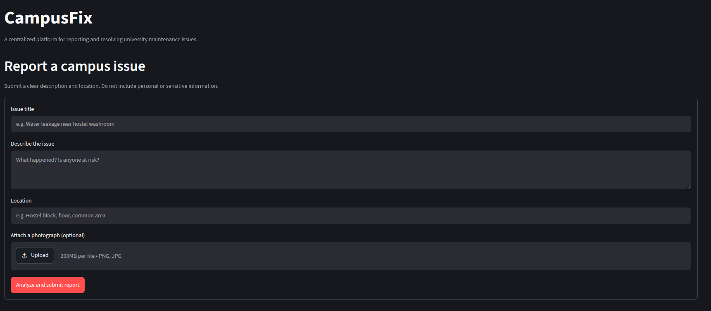
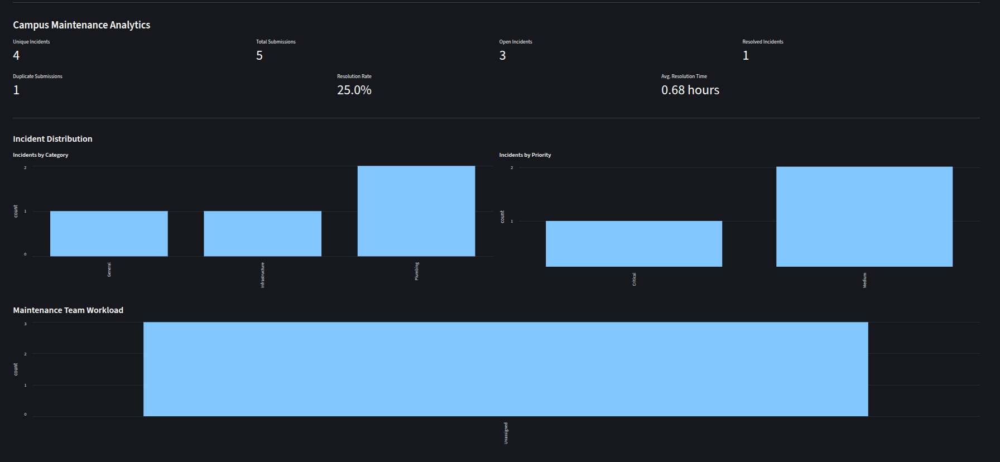
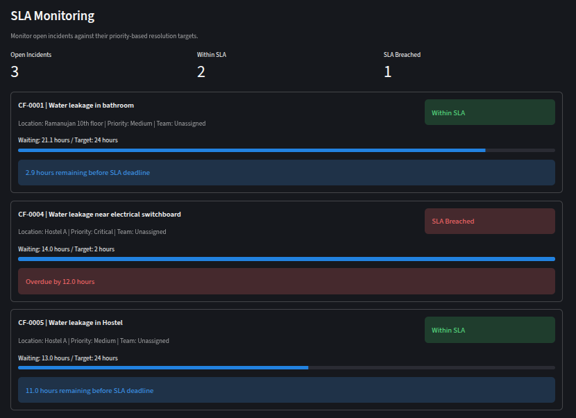
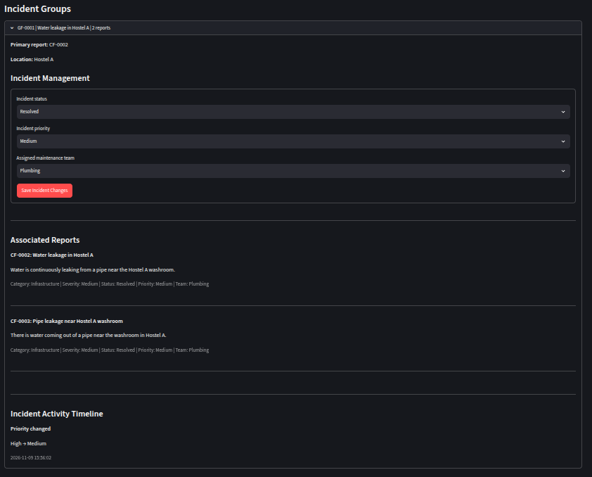
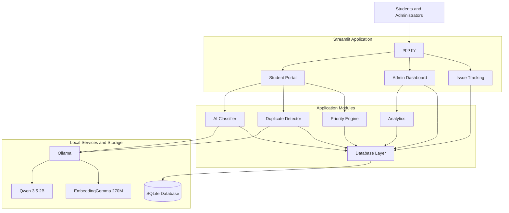

# CampusFix 🏫

[](LICENSE)

CampusFix is a university campus maintenance and issue-management platform built with Python and Streamlit.

Students can report maintenance problems, while administrators can review reports, identify duplicate incidents, prioritize issues, manage resolutions, and track safety responses.

## Features

- Student maintenance issue reporting
- AI-assisted issue classification using local Ollama models
- Semantic duplicate detection using local embeddings
- Administrator-reviewed duplicate suggestions
- Incident grouping without deleting individual reports
- Priority assignment based on severity and safety risk
- Safety response acknowledgement and history
- Incident activity tracking
- Student-facing report tracking
- SQLite-based persistent storage

## Application Screenshots

### Student Portal
Students can submit maintenance reports with descriptions, locations and optional photographs.



### Admin Dashboard
Administrators can monitor campus incidents, review priorities, manage incident groups and inspect maintenance analytics.



### SLA Monitoring
Monitor open incidents against priority-based resolution targets and identify overdue maintenance requests.



### Incident Management
Review associated reports, update incident status and priority, assign maintenance teams and inspect the incident activity timeline.



## System Architecture



## Technology Stack

- Python
- Streamlit
- SQLite
- Ollama
- Qwen 3.5 2B for local classification
- EmbeddingGemma 270M for semantic embeddings
- NumPy
- Pandas
- Plotly

## Requirements

- Python 3.14 (development environment)
- Ollama
- Git

No paid AI API key is required.

## Installation

Clone the repository:

```bash
git clone <YOUR_REPOSITORY_URL>
cd CampusFix
```

Activate your Conda environment, or use an existing Python environment.

Install dependencies:

```bash
pip install -r requirements.txt
```

## Local AI Setup

Install Ollama and download the required models:

```bash
ollama pull qwen3.5:2b
ollama pull embeddinggemma-2:270m
```

Start Ollama if it is not already running:

```bash
ollama serve
```

Copy the example environment configuration:

```bash
cp .env.example .env
```

The default configuration uses:

- `http://localhost:11434`
- `qwen3.5:2b`
- `embeddinggemma-2:270m`

## Run CampusFix

From the project root:

```bash
streamlit run app.py
```

Streamlit will provide a local URL, usually:

```text
http://localhost:8501
```

## Run Tests

Run the test suite:

```bash
PYTEST_DISABLE_PLUGIN_AUTOLOAD=1 python -m pytest -v
```

The plugin-autoload setting avoids conflicts with unrelated installed pytest plugins.

## Database

CampusFix uses SQLite for persistent storage.

The application initializes its database automatically using:

```text
database/schema.sql
```

The local database is stored in:

```text
campusfix.db
```

Do not commit database files or real student submissions to version control.

## Project Structure

```text
CampusFix/
├── app.py
├── database/
│   ├── db.py
│   └── schema.sql
├── modules/
│   ├── ai_classifier.py
│   ├── duplicate_detector.py
│   ├── priority_engine.py
│   ├── analytics.py
│   └── issue_manager.py
├── pages/
│   ├── student_portal.py
│   ├── admin_dashboard.py
│   └── issue_tracking.py
├── scripts/
├── tests/
├── uploads/
├── requirements.txt
├── .env.example
└── .gitignore
```

## Design Principles

- AI suggestions do not automatically merge reports.
- Administrators explicitly approve duplicate incident grouping.
- Individual student reports remain preserved.
- Safety-related reports receive special handling.
- Local AI services provide classification and semantic search.
- Student-facing tracking avoids exposing private administrative notes.

## Current Status

Development prototype. The automated test suite currently contains 16 passing tests.

## Application Workflow

1. A student submits a maintenance report with a title, description and location.
2. The local AI classifier analyzes the report and provides an initial category, severity and safety assessment.
3. The duplicate detector searches for potentially related reports using semantic embeddings and location matching.
4. Potential duplicates are presented to an administrator for review. Reports are never automatically merged.
5. Administrators manage incident status, priority, maintenance-team assignment and safety responses.
6. Students can track report progress and view the public-facing activity timeline.

## Automated Testing

CampusFix includes tests for:

- Database operations and incident management
- Duplicate candidate review and confirmation
- Safety response history and privacy
- Priority calculation
- Student report submission
- Administrator duplicate-review workflow

Run locally:

\`\`\`bash
PYTEST_DISABLE_PLUGIN_AUTOLOAD=1 python -m pytest -v
\`\`\`

GitHub Actions automatically executes the test suite on pushes and pull requests targeting `main`.

## Current Limitations

- CampusFix is a development prototype, not a production campus deployment.
- The application uses local SQLite storage.
- Local AI classification and semantic embeddings depend on the configured Ollama service.
- AI classifications are assessments and should be reviewed by administrators.
- Duplicate suggestions require explicit administrator approval.
- The current automated test suite uses mocked AI responses for predictable testing.

## Future Improvements

- Authentication and role-based access control
- Production database deployment
- Notifications for report status changes
- Improved mobile interface
- More comprehensive integration and load testing
