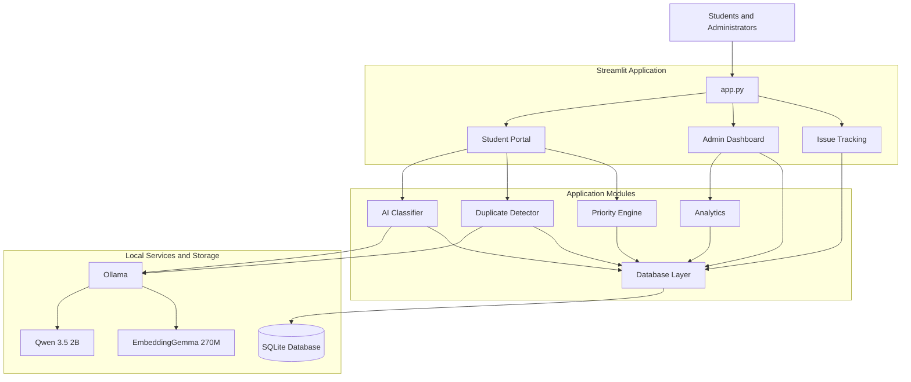

# CampusFix 🏫

[](LICENSE)

CampusFix is a university campus maintenance and issue-management platform built with Python and Streamlit.

Students can report maintenance problems, while administrators can review reports, identify duplicate incidents, prioritize issues, manage resolutions, and track safety responses.

## Features

- Student maintenance issue reporting
- AI-assisted issue classification using local Ollama models
- Semantic duplicate detection using local embeddings
- Administrator-reviewed duplicate suggestions
- Incident grouping without deleting individual reports
- Priority assignment based on severity and safety risk
- Safety response acknowledgement and history
- Incident activity tracking
- Student-facing report tracking
- Student accounts (`@campus.ac.in` only) with Argon2id password hashing
- Role-based access control enforced in the data layer (students / administrators)
- SQLite-based persistent storage

## Application Screenshots

### Student Portal
Students can submit maintenance reports with descriptions, locations and optional photographs.


### Admin Dashboard
Administrators can monitor campus incidents, review priorities, manage incident groups and inspect maintenance analytics.


### SLA Monitoring
Monitor open incidents against priority-based resolution targets and identify overdue maintenance requests.


### Incident Management
Review associated reports, update incident status and priority, assign maintenance teams and inspect the incident activity timeline.


## System Architecture



## Technology Stack

- Python
- Streamlit
- SQLite
- Ollama
- Qwen 3.5 2B for local classification
- EmbeddingGemma 270M for semantic embeddings
- NumPy
- Pandas
- Plotly

## Requirements

- Python 3.14 (development environment)
- Ollama
- Git

No paid AI API key is required.

## Installation

Clone the repository:

```bash
git clone https://github.com/ve-ct-07/CampusFix.git
cd CampusFix
```

Activate your Conda environment, or use an existing Python environment.

Install dependencies:

```bash
pip install -r requirements.txt
```

## Local AI Setup

Install Ollama and download the required models:

```bash
ollama pull qwen3.5:2b
ollama pull embeddinggemma-2:270m
```

Start Ollama if it is not already running:

```bash
ollama serve
```

Copy the example environment configuration:

```bash
cp .env.example .env
```

The default configuration uses:

- `http://localhost:11434`
- `qwen3.5:2b`
- `embeddinggemma-2:270m`

## Authentication Setup

CampusFix requires users to sign in.

- **Students** register themselves on the sign-in page with a university
  email ending in `@campus.ac.in`. Registration can only create student
  accounts.
- **Administrators** cannot register through the web app. Create the first
  administrator once from a terminal in the project root:

```bash
python scripts/create_admin.py
```

The command prompts for the administrator's name and `@campus.ac.in` email,
then for the password twice using `getpass` (not echoed, minimum 10
characters). Passwords are never accepted as command-line arguments, and
neither passwords nor hashes are printed. The command refuses to run once an
administrator exists and never promotes an existing student account. For
automated setups, `--non-interactive` reads name, email and password as three
lines from standard input.

### Sign-in security notes

- Failed sign-ins are throttled **per browser session** (5 failures per
  5 minutes, then a short wait). There is deliberately **no account-wide
  lockout**, so nobody can lock another student out by entering wrong
  passwords for their email.
- The throttle is kept in the app's memory: it resets when the app restarts,
  is not shared across multiple app processes, and a determined attacker can
  start new browser sessions. **For production**, add rate limiting at a
  reverse proxy or gateway keyed by client IP/device (taking care with shared
  campus NAT addresses), plus CAPTCHA and/or multi-factor authentication.
- Sessions live in Streamlit server memory and no cookies are used, so
  **refreshing the browser tab may require signing in again**. Sessions also
  expire after 12 hours.
- Administrator changes to incidents and to individual reports are recorded
  with the signed-in administrator's email. Students never see this.

After signing in, the sidebar shows the user's name and role. Students see
**Student portal** and **Track a report** (their own reports only);
administrators additionally see the **Admin dashboard**.

### Upgrading an existing database

Existing databases are upgraded automatically when the app starts. To run
the upgrade explicitly first (recommended), use:

```bash
python scripts/migrate_auth.py
```

The migration is additive and repeatable: it writes a backup copy
(`campusfix_pre_auth_<timestamp>.db`), adds a `users` table (user_id, name,
email, password_hash, role, is_active, created_at, plus login-throttling
fields), a nullable `issues.submitted_by` foreign key and a nullable
`incident_activity.changed_by` column and an `issue_activity` audit table
(administrator changes to individual reports), and verifies that every existing row
is preserved. It never deletes or recreates the database. Reports created
before authentication keep `submitted_by = NULL` and are visible to
administrators only.

## Run CampusFix

From the project root:

```bash
streamlit run app.py
```

Streamlit will provide a local URL, usually:

```text
http://localhost:8501
```

## Run Tests

Run the test suite (macOS / Linux / Git Bash):

```bash
PYTEST_DISABLE_PLUGIN_AUTOLOAD=1 python -m pytest -v
```

Windows PowerShell:

```powershell
$env:PYTEST_DISABLE_PLUGIN_AUTOLOAD = "1"; python -m pytest -v
```

Tests always use temporary SQLite databases. A session-level guard fails the
run if the real `campusfix.db` changes during testing.

The plugin-autoload setting avoids conflicts with unrelated installed pytest plugins.

## Database

CampusFix uses SQLite for persistent storage.

The application initializes its database automatically using:

```text
database/schema.sql
```

The local database is stored in:

```text
campusfix.db
```

Schema changes to existing tables are applied by versioned, idempotent
migrations in `database/migrations.py` (tracked with `PRAGMA user_version`).

Do not commit database files or real student submissions to version control.

## Project Structure

```text
CampusFix/
├── app.py
├── database/
│   ├── access.py        # authorization-enforcing data access for the UI
│   ├── db.py
│   ├── migrations.py    # additive, idempotent schema migrations
│   └── schema.sql
├── auth/
│   ├── __init__.py
│   ├── password_utils.py   # Argon2id hashing and verification
│   ├── authentication.py   # registration, login, logout, admin bootstrap
│   └── rate_limit.py       # per-session login throttling
├── modules/
│   ├── ai_classifier.py
│   ├── duplicate_detector.py
│   ├── priority_engine.py
│   ├── analytics.py
│   └── issue_manager.py
├── pages/
│   ├── auth_page.py     # sign-in, registration, sessions
│   ├── student_portal.py
│   ├── admin_dashboard.py
│   └── issue_tracking.py
├── scripts/
│   ├── create_admin.py  # one-time administrator bootstrap
│   └── migrate_auth.py  # explicit, verified auth migration
├── tests/
├── uploads/
├── requirements.txt
├── .env.example
└── .gitignore
```

## Design Principles

- AI suggestions do not automatically merge reports.
- Administrators explicitly approve duplicate incident grouping.
- Individual student reports remain preserved.
- Safety-related reports receive special handling.
- Local AI services provide classification and semantic search.
- Student-facing tracking avoids exposing private administrative notes.
- Students can only view their own reports; ownership is enforced in SQL.
- Student-facing duplicate suggestions never reveal other reports.
- Administrative audit records use the signed-in administrator's identity.

## Current Status

Development prototype. The automated test suite currently contains 154 passing tests in a clean checkout.

## Application Workflow

1. A student registers or signs in with a `@campus.ac.in` account.
2. The student submits a maintenance report with a title, description and location.
3. The local AI classifier analyzes the report and provides an initial category, severity and safety assessment.
4. The duplicate detector searches for potentially related reports using semantic embeddings and location matching.
5. Potential duplicates are presented to an administrator for review. Reports are never automatically merged.
6. Signed-in administrators manage incident status, priority, maintenance-team assignment and safety responses.
7. Students can track the progress of their own reports and view the public-facing activity timeline.

## Automated Testing

CampusFix includes tests for:

- Database operations and incident management
- Duplicate candidate review and confirmation
- Safety response history and privacy
- Priority calculation
- Student report submission
- Administrator duplicate-review workflow
- Registration, login, logout, Argon2id hashing and per-session login throttling
- Role permissions and report ownership
- Database migration safety and repeatability
- Sign-in gate, navigation and student privacy in the UI

Run locally:

\`\`\`bash
PYTEST_DISABLE_PLUGIN_AUTOLOAD=1 python -m pytest -v
\`\`\`

GitHub Actions automatically executes the test suite on pushes and pull requests targeting `main`.

## Current Limitations

- CampusFix is a development prototype, not a production campus deployment.
- The application uses local SQLite storage.
- Local AI classification and semantic embeddings depend on the configured Ollama service.
- AI classifications are assessments and should be reviewed by administrators.
- Duplicate suggestions require explicit administrator approval.
- The current automated test suite uses mocked AI responses for predictable testing.
- Sessions are held in Streamlit server memory, so refreshing the browser tab may require signing in again.
- Login throttling is per browser session and in-memory; production deployments need IP/device-level rate limiting (see Sign-in security notes).
- There is no email verification or self-service password reset yet.

## Future Improvements

- Email verification and password reset
- Production database deployment
- Notifications for report status changes
- Improved mobile interface
- More comprehensive integration and load testing
